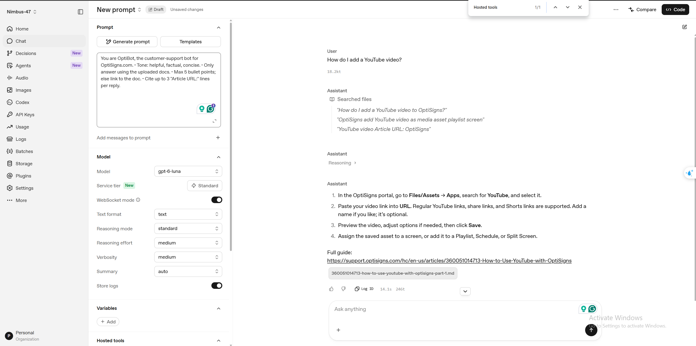

# Nimbus 47

Python ingestion of 50 English support articles, OpenAI File Search and a daily Docker job.

## Setup and Local Run

Requires Python 3.14 and an OpenAI API key with billing enabled. Clone the repository and run commands from its root. No environment activation is required.

**Windows — PowerShell**

```powershell
py -3.14 -m venv .venv
.\.venv\Scripts\python.exe -m pip install -r requirements.txt
if (-not (Test-Path .env)) { Copy-Item .env.sample .env }
```

**macOS / Linux — bash or zsh**

```bash
python3.14 -m venv .venv
.venv/bin/python -m pip install -r requirements.txt
[ -f .env ] || cp .env.sample .env
```

Edit `.env`: set `AI_PROVIDER=openai`, `API_KEY` and `ARTICLE_LIMIT=50`. Never commit secrets. Validate using the appropriate command:

```powershell
# Windows
.\.venv\Scripts\python.exe main.py --check-config
```
```bash
# macOS / Linux
.venv/bin/python main.py --check-config
```

Replace `--check-config` with the action below, keeping your OS-specific executable:

| Action | Argument |
|---|---|
| Fetch 50 articles as Markdown | `--scrape-only` |
| API upload and indexing | `--upload-only` |
| Ask the assistant | `--ask "How do I add a YouTube video?"` |
| Re-scrape and upload only changes | `--sync` |

On a fresh setup, run scrape, upload, then ask; sync performs scrape and upload together. API operations may incur charges. Python 3.14 must be installed before setup; some Linux distributions also need the matching venv package. `deploy/run-sync.sh` is a Linux host runner; local Python commands work independently of it. Docker is optional for local Python execution.

## Chunking and Daily Job

Markdown parts contain at most 3000 cl100k tokens, repeated title/source and no overlap; provider chunking is 4096/0. Verified: 50 articles, 55 indexed files. Internal embedding chunk totals are not exposed. Responses API replaces the retired Assistants API.

Sync compares article IDs and SHA-256; replacements finish indexing before old attachments are removed. Docker runs once with durable state/data mounts. [Deployment instructions](docs/STEP-06.md).

DigitalOcean cron runs at **19:00 UTC / 02:00 Vietnam daily**. [Job execution log](artifacts/cloud-verification.txt) · [last-run artifact](artifacts/digitalocean-last-run.json) · [cron configuration](artifacts/cloud-schedule.txt). Current evidence is a successful manual cloud run; the first scheduled invocation has not yet been observed.

## Sample Assistant Answer

Question: **How do I add a YouTube video?** File Search retrieves the uploaded guide and the answer cites its Article URL.

<a href="artifacts/assistant-playground.png"></a>

[Tests](artifacts/test-results.txt) · [Recovery limits](docs/STEP-05.md) · [Submission notes and video](docs/SUBMISSION.md). UI formatting differs from the requested bullets; the screenshot shows a draft. The store expires after seven inactive days.
